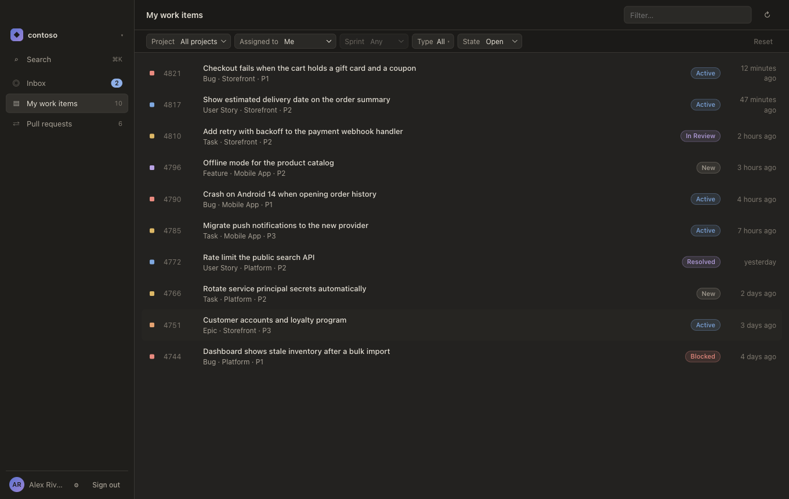
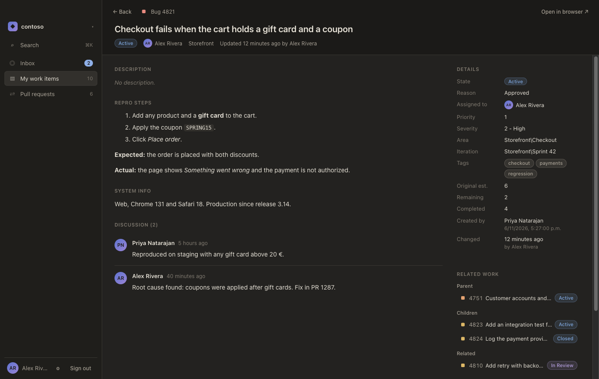
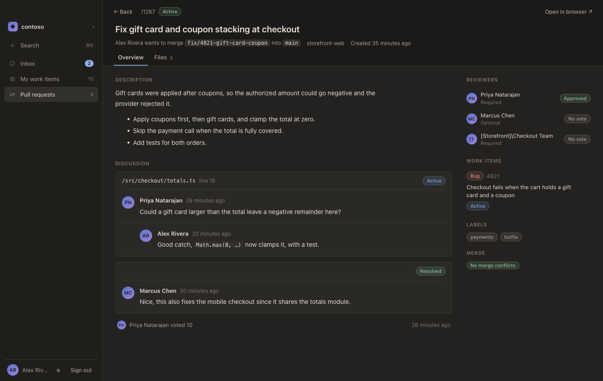
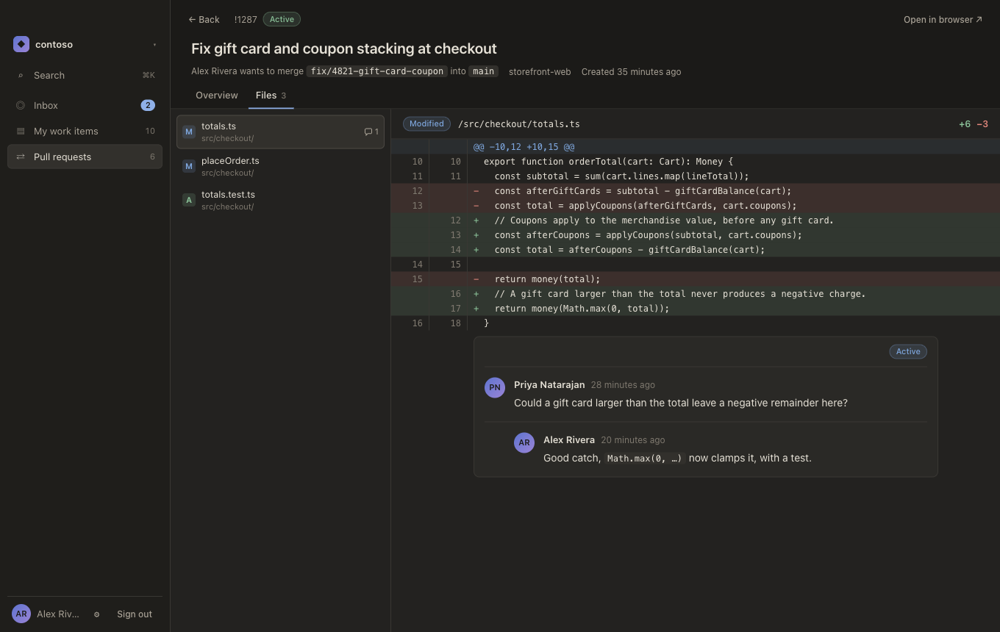
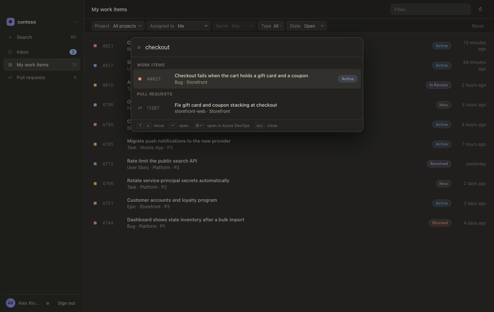
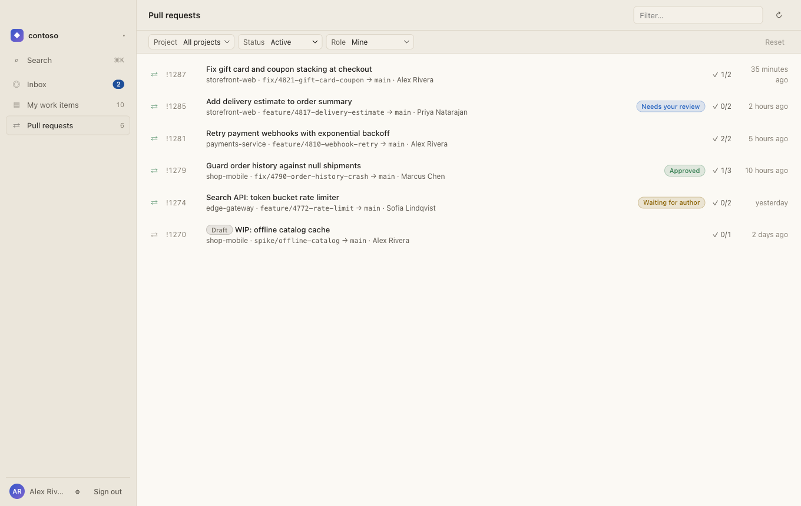

# ADO Desk

Proof of concept: a desktop app (Tauri 2 + React + TypeScript) that shows your Azure Boards
work items and Azure Repos pull requests.



## Screenshots

The organization, projects, people and items shown are fictional.

| | |
|---|---|
|  |  |
| **Work item**: description, repro steps, discussion, fields and related work. | **Pull request**: description, comment threads, reviewers and linked work items. |
|  |  |
| **Files**: changed files with the diff and its comments inline. | **Quick search** (⌘K): work items and pull requests across organizations. |



Light and dark themes follow the system or can be picked in Settings, including themes imported from Open VSX.

## Run

```bash
pnpm install
pnpm tauri dev      # first build compiles the Rust side and takes a few minutes
```

To install a release build locally (macOS), run `pnpm app:install`. It builds `ADO Desk.app`,
quits a running copy, replaces `/Applications/ADO Desk.app` and opens it (`--no-open` skips the last step).
On first launch, choose "Always Allow" when macOS asks for keychain access.

On Windows, run `pnpm tauri build` (requires the Visual Studio C++ Build Tools and Rust with the MSVC
toolchain) and run the installer from `src-tauri/target/release/bundle/nsis/` or `bundle/msi/`.

## CI

`.github/workflows/ci.yml` runs on every pull request to `main` (and on pushes to `main`), on macOS and
Windows: `pnpm build` (type check + frontend build), `cargo clippy --all-targets -- -D warnings` and
`cargo test`.

## Release

Every push to `main` publishes a release (`.github/workflows/release.yml`):

1. `scripts/release-plan.mjs` reads the [Conventional Commits](https://www.conventionalcommits.org) since the
   latest `v*` tag and picks the next version: a breaking change (`feat!:` or a `BREAKING CHANGE:` footer)
   bumps major (minor while on 0.x), `feat` bumps minor, anything else bumps patch.
2. It builds installers for macOS (Apple Silicon and Intel, `.dmg`) and Windows (x64, NSIS `.exe`), with that
   version injected at build time. The version in `tauri.conf.json`, `Cargo.toml` and `package.json` is not
   bumped; the tag is the source of truth.
3. It tags the pushed commit and publishes the release. The notes list the changes grouped by type
   (breaking changes, features, fixes, performance, other) followed by `.github/release-notes.md`.

Write commit subjects (or squash-merge PR titles) as Conventional Commits, since they become the release notes.
A manual run from the Actions tab only builds; the installers are attached to the run as artifacts.
Run the release script tests with `pnpm test:scripts`.

## Sign in

Create a [personal access token](https://learn.microsoft.com/azure/devops/organizations/accounts/use-personal-access-tokens-to-authenticate)
with these scopes:

- **Work Items**: Read
- **Code**: Read
- **Project and Team**: Read (used to discover projects for the pull request list)
- **Build**: Read (optional: build status on pull requests; without it, builds show as unavailable and everything else still loads)
- **Work Items**: Read & Write (optional: work item actions; without it, the work item detail stays read-only with a hint)
- **Code**: Read & Write (optional: pull request actions; without it, a refused vote, comment, reply or thread change switches the pull request detail to read-only with a hint)

Enter your organization (`contoso` or `https://dev.azure.com/contoso`) and the token.
The token is validated against Azure DevOps, then stored in the OS credential store
(macOS Keychain / Windows Credential Manager / Secret Service). It never returns to the webview.

## Quick search

Press **⌘K** (Ctrl+K on Windows/Linux) or click *Search* in the sidebar:

- `#123` opens work item 123, `!45` opens pull request 45, a bare number looks up both.
- Other text (2+ characters) searches titles: work items through WIQL across every project, and
  your own pull requests (author or reviewer, any status), since Azure DevOps has no title filter
  for pull requests. Any pull request still opens by `!id`.
- Every configured organization is searched, the active one first. Opening a result from another
  organization switches to it. An organization that cannot be searched (for example an expired
  token) is named above the results; the others still answer.
- Arrows move, Enter opens in the app, ⌘Enter opens in Azure DevOps, Esc closes. With nothing
  typed, it lists the items you opened recently (stored on this device only).

## Background mode

Closing the main window hides it; ADO Desk keeps running behind its menu bar icon (Open ADO
Desk, Search…, Settings…, Quit). Click the Dock icon (on Windows, left-click the tray icon) or *Open ADO Desk* to bring the window back. Quit
from the menu bar icon or with ⌘Q.

## Global search bar

Press **⌘⇧Space** (Ctrl+Shift+Space on Windows/Linux) from any app, or pick *Search…* in the
menu bar icon: a floating bar searches like ⌘K. Enter brings ADO Desk forward with the item open
(switching organization when needed), ⌘Enter opens it in Azure DevOps, Esc or clicking elsewhere
hides the bar. It is a normal window, so it does not appear over full-screen apps.

Settings > Shortcuts turns the shortcut off or records a new one (Command, Control or Alt plus a
key; Shift alone is not enough). A combination another app already uses is rejected and the
previous one stays active. If the saved shortcut is taken when ADO Desk starts, the bar is still
available from the menu bar icon.

## Work item actions

With **Work Items: Read & Write**, the work item detail lets you change the state (after a
confirmation), change the assignee (a member of the project's default team, or you) and add a
plain-text comment. Your own comments can be deleted (after a confirmation) and, when they hold
plain text only, edited; comments with formatting, mentions or Markdown are edited in Azure
DevOps, so the app never drops their formatting. Every write runs in Rust with validated values
only; state and assignee changes are refused if the item changed since it loaded, a comment edit
or delete is refused unless the comment is still yours and unchanged, and the item and its
comments are read again from Azure DevOps after each write. Without the scope the actions are hidden behind a hint;
a refused write never signs you out.

## Pull request actions

With **Code: Read & Write**, the pull request Overview lets you vote (approve, approve with
suggestions, wait for author, reject, or reset your vote) after a confirmation, and the Files tab
lets you comment on lines: click a line number to select it (Shift+click another line in the same
block to select a range), write the comment (Markdown, up to 4000 characters) and save it as a new
thread on those lines. Line numbers on the left side comment on the original file, on the right
side on the changed one. Comment threads, in the Overview and in the diff, take a reply (Markdown,
up to 4000 characters) and can be resolved, or reactivated once resolved or closed. Votes, new
comments, replies and thread changes are only offered on open pull requests. Writes run in Rust with validated values only, and the pull request and
its threads are read again afterwards. A refused write never signs you out; it switches that pull
request to read-only with a hint. `.md` files in the Files tab can also switch between their diff
and a rendered preview (links and images relative to the repository are not shown).

## Assistant

The **Assistant** panel (sidebar, or ⌘J / Ctrl+J) opens Claude Code in a terminal at the bottom of
the main window. It runs the `claude` CLI you already installed, signed in with your own Claude
account or API key through Claude Code's own sign-in; ADO Desk never reads or stores those
credentials. Install Claude Code from https://code.claude.com/docs first.

- ADO Desk finds `claude` on your login shell's PATH (an app opened from Finder does not inherit
  it), then on the app's own PATH, then in `~/.local/bin`, `~/.claude/local`, `/opt/homebrew/bin` and `/usr/local/bin`. Set an
  exact path in Settings > Assistant when it lives elsewhere.
- Sessions start in an empty folder owned by ADO Desk (in its app data directory), or in the
  folder set in Settings > Assistant. Claude Code can read and change files in that folder.
- **✦ Ask** in a work item or pull request header opens the panel and types "About work item
  123, open in ADO Desk: " (or the pull request equivalent) without sending it, so you finish the
  question. Only the id is typed: titles are written by other people, so Claude reads them through
  its tools instead of your prompt.
- Hiding the panel keeps the session; *Restart* ends it and starts a new one. Switching
  organization or quitting ADO Desk ends it.

**What Claude can see.** With the first session, ADO Desk starts a local MCP server (`ado-desk`)
that the session loads through `--mcp-config`. Its read tools work on the active organization and
run without asking:

- `current_view`: the work item, pull request or list you have open;
- `get_work_item`: fields, description and the 20 most recent comments;
- `get_pull_request`: details, reviewers and votes, comment threads and changed files.

So you can ask "summarize this pull request" or "what is left on this bug?" about whatever is on
screen. The server listens on 127.0.0.1 only, on a random port, and requires a token created at
each app launch, which reaches Claude Code only through the `ADO_DESK_MCP_TOKEN` environment
variable of its terminal; requests from a browser (with an `Origin` header) or for another host
name are refused. Your Azure DevOps token stays in ADO Desk. Text from Azure DevOps is written by
other people, and Claude Code is told to treat it as data, not instructions.

## Notifications

While ADO Desk runs (also with the window closed), it checks every configured organization every
5 minutes (Settings > Notifications: 1 to 60 minutes, or off) for:

- pull requests waiting for your review (you are a reviewer and have not voted),
- open work items newly assigned to you,
- new comments by others on your active pull requests and your assigned work items.

New items show as native notifications (a single summary when there are more than 3) and in the
**Inbox**, with an unread count in the sidebar, on the Dock icon and next to the menu bar icon (on Windows: a red dot on the taskbar icon and the count in
the tray tooltip).
Desktop notifications cannot open an item when clicked, so open it from the Inbox. The first check
of an organization only records what is already there. Seen state and the Inbox (last 100 items)
are stored in `notification-state.json` and `inbox.json` in the app config directory; no comment
text is stored, only titles and author names. In `pnpm tauri dev` macOS may attribute or hold
notifications differently than in the bundled app.

## Themes

Settings > Appearance offers built-in reading themes for light and dark mode, translucency
(macOS vibrancy, Mica on Windows 11) and a glass slider that applies to the whole window.

**Import from Open VSX**: click *Browse themes*, search, and import a VS Code color theme
extension. Every color theme in it is added to the Light or Dark picker (hover a card to
remove it). Notes:

- This is the only network call outside Azure DevOps. It runs in Rust, only when you open the
  browser or search, and only against `https://open-vsx.org` (downloads may redirect only to Open
  VSX storage, `openvsx.eclipsecontent.org`, over HTTPS). Nothing about your organizations is sent.
- The `.vsix` is read in memory with size caps and never unpacked to disk. Only the theme
  colors are kept, mapped onto the app's tokens; tokens a theme does not define are derived
  or come from the default built-in theme.
- Imported themes are stored in `imported-themes.json` in the app config directory.
  Reimporting an extension replaces its themes.
- Imported themes are not contrast-checked like the built-in ones.

## Architecture

```
src/                      React UI (no network access; CSP allows IPC only)
  lib/api.ts              Typed wrappers over Tauri commands
  features/auth           Login screen
  features/workspace      Sidebar, work item list, pull request list
src-tauri/src/
  commands.rs             Tauri commands: login, restore_session, logout, list_*
  credentials.rs          OS keychain storage
  azdo/client.rs          HTTP adapter for the Azure DevOps REST API 7.1
  azdo/model.rs           Domain types and pure payload mapping (unit tested)
  search.rs               Quick search: query syntax, title WIQL, PR title filter
  search_bar.rs           Floating search window, global shortcut validation/registration
  background.rs           Menu bar icon, hide-on-close, Dock reopen
  notifications/          Background checks: rules (what is new), fetch, Inbox store, loop
  themes/                 Open VSX search/import, vsix reader, VS Code color mapping, store
  assistant/              Assistant panel: `claude` lookup, terminal (PTY) sessions, local MCP server
```

- Work items: WIQL `[System.AssignedTo] = @Me` excluding Closed/Done/Removed, up to 200.
- Pull requests: active PRs per project where you are the creator or a reviewer.

## Tests

```bash
cd src-tauri && cargo test
cargo test live_open_vsx -- --ignored   # optional: imports real themes from open-vsx.org
```

## Next steps

- Replace PAT with Microsoft Entra ID OAuth (Azure DevOps OAuth is deprecated).
- Pagination and caching; PR details and work item detail panes.
